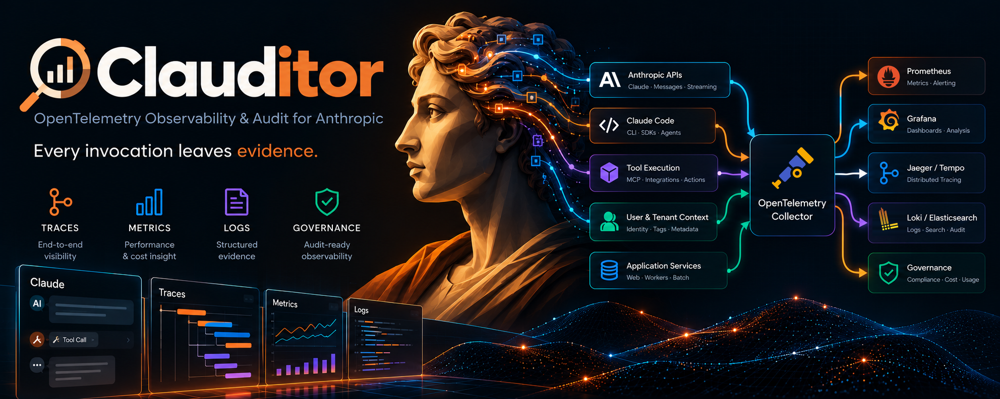

# Clauditor

  

<strong>Every invocation leaves evidence.</strong>

**Clauditor** is a proposed OpenTelemetry-native observability and audit tool for Anthropic workloads. The goal is to make model and tool activity inspectable through correlated traces, metrics, logs, and governance-grade event context—without assuming that a model's own account of its actions is proof.

The illustration is a product vision, **not a claim that the depicted integrations or features exist yet**. This repository begins as a governed project scaffold; product design and implementation follow in separately approved work.

## BCF-governed development

Clauditor adopts [BCF Governance](https://github.com/mjgolaszewski/bcf-governance) to constrain agent-developed software with machine-readable authority, structural invariants, executable gates, causal negative controls, and evidence-based lifecycle truth. The canonical BCF runtime is pinned for initial bootstrap to **v2.3.6**. BCF, not an agent's prose, computes whether a declared claim is substantiated for its source and evidence dependencies.

**Adoption sequence:** bootstrap with **Lite**, then promote to **Standard / profile contract 3.0** only when real application gate commands, semantic ownership classifications, and a reviewable CI graph exist. No Standard-v3 readiness, certification, release approval, or working controller is claimed at bootstrap.

**No persistent controller.** Clauditor is intended to be an *ordinary BCF adopter*: no installed long-lived BCF controller, controller rotation, self-governance overlays, dedicated controller GitHub App, self-publication infrastructure, or controller recovery topology. Standard-v3 may still require ephemeral trusted CI/control jobs and an executable BCF verifier; those are not a persistent controller and must follow the canonical v3 contract.

After canonical BCF installation, [`AGENTS.yml`](AGENTS.yml), [`governance-profile.yml`](governance-profile.yml), the files under `governance/`, and `plans/` become the operative source authorities. `.github/workflows/` is a deterministic projection of `governance/ci-graph.yml` after Standard-v3 promotion; generated workflows are **not** edited by hand.

See [the scoped Standard-v3 target](spec/BCF_STANDARD_V3_TARGET.md) and [bootstrap instructions](docs/BOOTSTRAP.md). The design follows the BCF chain **invariant → canonical owner → primitive → contract → producer → consumer → evidence** and does not create an independent substitute for BCF's vocabulary or schemas.

 

## Product target

The MVP is a **single-tenant, self-hosted Linux Docker Compose appliance** for an RIA compliance administrator, covering eligible Cowork/Claude sessions, Claude Code, Anthropic API traces and instrumented SDK traces. It aims to retain source-emitted prompts, responses, tools, skills, connectors and artifacts, with explicit coverage and content-truncation indicators. The candidate design uses the OpenTelemetry Collector, ClickHouse OSS and Grafana OSS for SQL reporting and alerting, with 365-day target retention (90-day approved fallback; 31-day minimum). These remain product requirements, not deployed features.

## What Clauditor aims to make observable

- **Traces:** correlated model requests, operations, tool calls, and service boundaries, where instruments can actually observe them.
- **Metrics:** latency, throughput, failures, token usage, and cost *where reliable source data and pricing inputs exist*.
- **Logs:** structured, trace-correlated operational records with explicit treatment of sensitive content.
- **Governance:** retained, attributable evidence with provenance, retention, access control, and clear limits on what the evidence proves.

The hero depicts possible relationships among Anthropic APIs, Claude Code, tool execution, OpenTelemetry, Prometheus, Grafana, Jaeger/Tempo, and Loki/Elasticsearch. **Support for any particular source, sink, or audit guarantee is not yet specified or implemented.** Internal model processing that is not surfaced by a provider cannot be inferred as fact from exterior telemetry.

## Engineering posture

Instrumentation and collection should build on open telemetry standards rather than a proprietary evidence format by default. Operational signals must not be confused with authoritative audits: correlation, actor/tenant attribution, trustworthy timestamps, provenance, integrity, and privacy rules need explicit contracts before consequential claims can be made.

BCF manages **development governance**; Clauditor's eventual **product observability and audit semantics** will be specified separately. Neither BCF checks nor telemetry by themselves prove regulatory compliance, completeness of underlying provider data, or correctness of a model's output.

## Current status

**BCF Standard profile contract 3.0 promoted and provider-verified; construction paused.** The owner-uploaded hero is in [`assets/clauditor-hero.png`](assets/clauditor-hero.png). The [machine-readable Clauditor v1 product requirements](spec/clauditor/v1/README.md) remain the full MVP candidate. A bounded qualification slice now exercises authenticated OTLP, a typed archive and ClickHouse with synthetic logs, traces and metrics, plus a read-only archive-inspection CLI. Live Anthropic onboarding, Grafana reporting, alerting, retention sizing and full appliance acceptance remain planned. No production deployment or release is approved.

For bootstrap provenance and the canonical promotion procedure, follow [the bootstrap guide](docs/BOOTSTRAP.md). The reviewed source-of-intent and executable candidate requirements are tracked under `spec/clauditor/v1/`; the bounded qualification slice and Standard-v3 promotion are implemented; full MVP construction remains pending.

## License and security

Copyright is reserved until the repository owner explicitly chooses an open-source license. Public readability does not grant permission to redistribute or modify. See [LICENSE](LICENSE) and [SECURITY.md](SECURITY.md). Never publish API keys, credentials, sensitive user content, or unredacted telemetry in issues or build logs.
